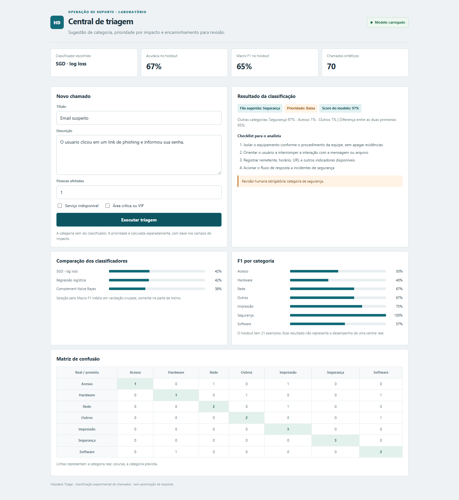

# Helpdesk Triage

Experimento de classificação de chamados de TI com machine learning tradicional. O objetivo é sugerir uma fila e destacar casos que não devem seguir sem análise de uma pessoa.



## O que o classificador faz

O texto do título e da descrição passa por normalização e TF-IDF (termos isolados e pares de termos). Durante o treinamento, três classificadores são comparados:

- Logistic Regression
- Complement Naive Bayes
- SGD com perda logarítmica

A seleção usa Macro F1 médio em validação cruzada estratificada no conjunto de treino. Depois, o modelo escolhido é medido em um holdout separado. A API expõe as métricas, a comparação e a matriz de confusão para que o resultado não fique escondido atrás de uma única porcentagem.

**O classificador não é um chatbot e não usa um LLM.** Ele classifica texto e continua separado do novo módulo experimental LLM RAG Assistant, documentado em [docs/LLM_RAG.md](docs/LLM_RAG.md). O assistente recupera trechos de documentação e gera respostas com fontes; não altera chamados nem executa ações em infraestrutura.

## Dados usados no experimento

O arquivo `data/tickets.csv` contém 70 exemplos sintéticos: dez por categoria (`network`, `hardware`, `software`, `access`, `printing`, `security` e `other`). A divisão é estratificada, com 70% para treino e 30% para holdout. A validação cruzada acontece somente dentro da parte de treino.

Esse conjunto é pequeno e foi escrito para exercitar o pipeline. As métricas atuais servem para comparar os experimentos deste repositório; não devem ser interpretadas como desempenho esperado em uma central de atendimento real.

## Categoria e prioridade são coisas diferentes

O classificador sugere a categoria. A prioridade é calculada por regras operacionais a partir de indisponibilidade, quantidade de pessoas afetadas e indicação de área crítica.

A API exige revisão humana quando ocorre pelo menos uma destas condições:

- A categoria sugerida é segurança.
- O impacto calculado é crítico.
- A confiança prevista fica abaixo de 0,72.
- A diferença entre as duas categorias mais prováveis fica abaixo de 0,12.

Esses limites são parâmetros iniciais do laboratório, não uma política universal. A probabilidade retornada pelo classificador não é uma confiança calibrada nem garantia de acerto.

## Executar

Requisitos: Python 3.12 ou superior.

```powershell
python -m venv .venv
.venv\Scripts\Activate.ps1
pip install -r requirements.txt
python train.py
uvicorn app:app --reload
```

Abra [http://127.0.0.1:8000](http://127.0.0.1:8000).

## Endpoints

| Método | Rota | Descrição |
|---|---|---|
| GET | `/health` | Estado da API e modelo carregado |
| GET | `/model/metrics` | Métricas do holdout |
| GET | `/model/comparison` | Resultado da validação cruzada |
| GET | `/model/confusion` | Matriz de confusão |
| POST | `/triage` | Classificar um chamado |
| POST | `/triage/batch` | Classificar até 100 chamados |

Exemplo de entrada:

```json
{
  "title": "Sem acesso à internet",
  "description": "O notebook conecta ao Wi-Fi, mas não resolve DNS.",
  "affected_users": 3,
  "service_stopped": false,
  "vip_or_critical_area": false
}
```

## Avaliação do RAG

O módulo RAG possui um benchmark local com documentos e perguntas sintéticos em português. Ele mede Recall@K, Precision@K, MRR, Hit Rate@K, latência, recuperação de paráfrases e abstenção em consultas sem fonte. O benchmark usa embeddings locais e não chama o LLM:

```bash
python scripts/evaluate_rag.py --top-k 4 --repeats 3
# compare um limite de relevância sem alterar o .env
python scripts/evaluate_rag.py --top-k 4 --repeats 3 --min-relevance 0.32
# compare o reranker lexical experimental (não usado no chat)
python scripts/evaluate_rag.py --retrieval-mode hybrid --top-k 4 --repeats 3 --min-relevance 0.18
# compare FTS5/BM25 + Reciprocal Rank Fusion (também experimental)
python scripts/evaluate_rag.py --retrieval-mode rrf --top-k 4 --repeats 3 --min-relevance 0.18 --rrf-bm25-cutoff -2.5
```

Para auditar citações de respostas capturadas, use o formato de `evaluation/answers.example.json` e passe o arquivo com `--answers`. A auditoria verifica integridade dos IDs e alinhamento com fontes esperadas; não substitui avaliação humana de suporte semântico. A avaliação v2 também mede a abstenção do retriever, não a qualidade textual da recusa do LLM. O modo hybrid é um reranker lexical experimental sobre candidatos vetoriais. O modo rrf adiciona busca BM25 independente com SQLite FTS5 e Reciprocal Rank Fusion; neste corpus, obteve 93,75% de Recall@4, 91,67% de Precision of returned e 5/5 abstenções corretas. Ambos permanecem fora do caminho de produção.

Veja [docs/LLM_RAG.md](docs/LLM_RAG.md) para métricas, limitações e detalhes de execução. Os resultados medidos localmente estão em [evaluation/RESULTS.md](evaluation/RESULTS.md).

## Testes

```bash
python -m pytest -q
```

Os testes cobrem categorias conhecidas, cálculo de prioridade, encaminhamento obrigatório para revisão, triagem em lote e validação de entrada.

## O que falta para um uso real

O dataset precisa ser substituído ou complementado por chamados representativos, anonimizados e autorizados. Também faltam monitoramento de qualidade, calibração das probabilidades, análise de deriva, versionamento formal dos modelos e avaliação com analistas. Até isso existir, a saída deve ser tratada como sugestão.

## LLM & RAG Assistant (módulo experimental)

O repositório também contém um copiloto de suporte separado do classificador tradicional. O padrão executa Qwen 3.5 localmente via Ollama e usa FastEmbed/ONNX para embeddings locais.

- Chat web em [/assistant/ui](http://127.0.0.1:8001/assistant/ui), com respostas em streaming e histórico limitado à sessão.
- Ingestão autenticada de documentos autorizados.
- Embeddings e busca semântica local em SQLite.
- Respostas fundamentadas no contexto recuperado, com citações [S1], [S2].
- Abstenção quando a recuperação não encontra material relevante.
- Tokens separados para chat e administração; nenhum token é armazenado no código.
- Hugging Face e OpenAI continuam como provedores opcionais, sujeitos a disponibilidade e créditos.

Consulte [docs/LLM_RAG.md](docs/LLM_RAG.md) para configuração, interface, chamadas de API, segurança e limitações.

## Fundamentos práticos de LLM

O diretório [examples/llm_foundations](examples/llm_foundations/README.md) reúne exemplos independentes para estudar chamadas a LLMs sem depender de créditos de API:

- Cliente HTTP para Ollama com validação de entrada, timeout e limite de resposta.
- Chat completion com mensagens `system` e `user`.
- Saída estruturada com JSON Schema e validação Pydantic.
- Testes automatizados com respostas simuladas, sem inferência ou rede.

O laboratório usa o modelo local configurado no Ollama. As saídas são sugestões e precisam ser validadas; os exemplos não executam ações em sistemas.
