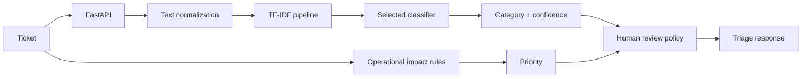
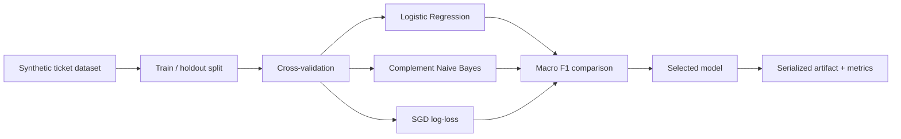

# Architecture

## Goal

AI Helpdesk is a local ML triage pipeline for classifying IT tickets while keeping priority rules and human review explicit.

## Request flow

## Training flow

## Design choices

Classification confidence never replaces operational impact. Critical tickets, security tickets and low-confidence predictions require human review. The repository contains synthetic data only.
