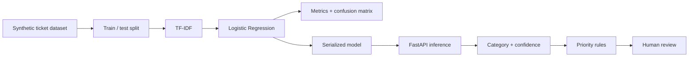

# Architecture

The classifier predicts the ticket category. Priority is intentionally handled by a separate deterministic policy using impact and outage information; classification confidence is not treated as incident severity.
