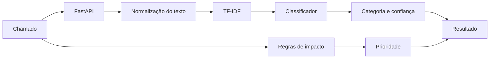
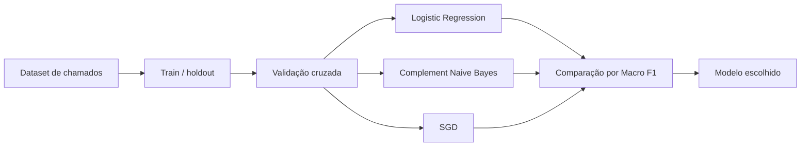

# Arquitetura

A classificação do chamado e a prioridade ficam separadas. O modelo tenta identificar a categoria; impacto e urgência continuam sendo tratados por regras simples.

## Treinamento

Chamados críticos, de segurança ou com confiança baixa continuam marcados para revisão manual. O dataset do repositório é de demonstração e não contém chamados reais.
