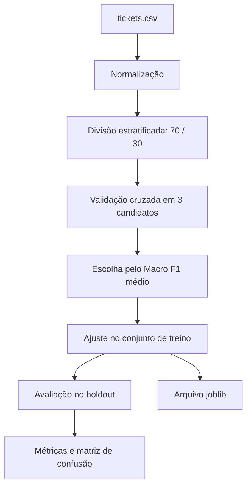
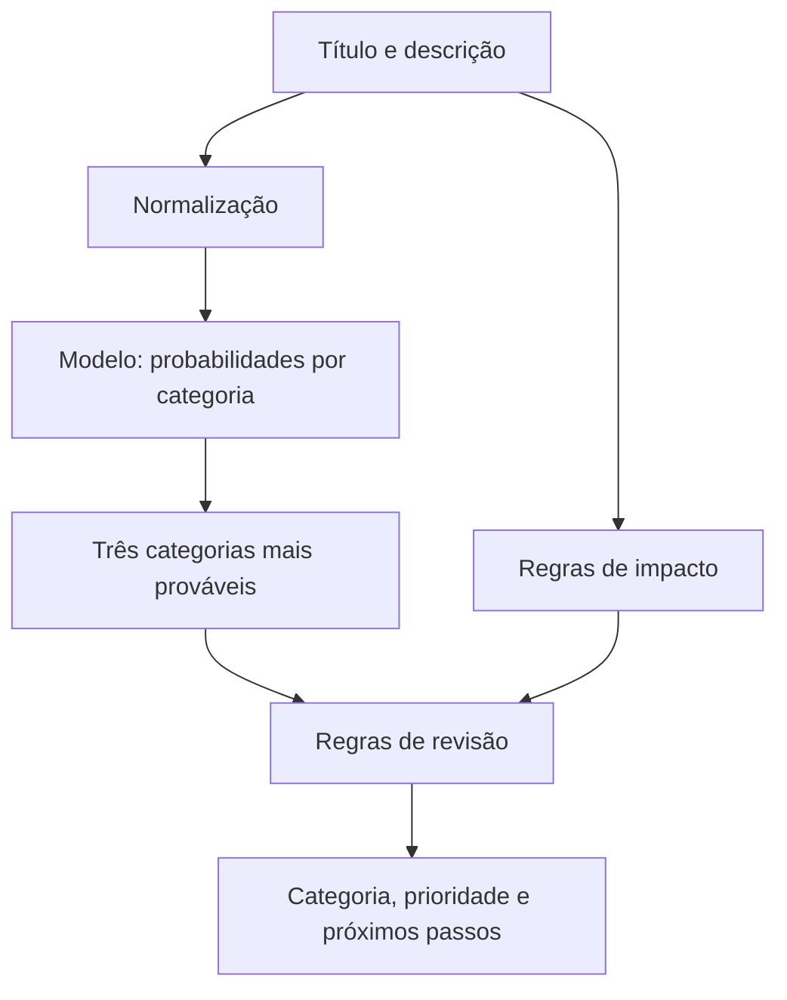

# Fluxo de treinamento e triagem

O serviço separa duas perguntas que costumam ser misturadas em ferramentas de suporte:

1. **Qual fila provavelmente deve receber o chamado?** Essa é a tarefa do classificador.
2. **Qual é o impacto operacional?** Essa decisão vem dos campos estruturados do chamado e de regras explícitas.

## Treinamento

O pipeline de texto usa TF-IDF com unigramas e bigramas. Os três candidatos são Logistic Regression, Complement Naive Bayes e SGD com `log_loss`. A semente fixa torna a divisão e os estimadores reproduzíveis dentro das versões de dependências usadas.

## Requisição de triagem

A revisão é obrigatória para chamados de segurança, impacto crítico, baixa confiança ou pouca separação entre as duas primeiras categorias. A prioridade não é aprendida pelo modelo.

## Limites do experimento

O dataset possui 70 linhas sintéticas, dez por categoria. Isso não cobre variações de linguagem, abreviações, erros de digitação ou distribuição real de chamados. As probabilidades de modelos lineares não foram calibradas. Por isso, a API informa alternativas e motivos de revisão, em vez de transformar a classificação em decisão automática.
